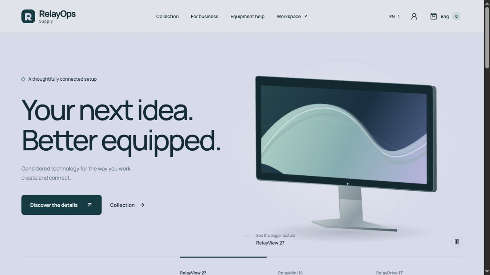

# RelayOps

A bilingual retail and procurement portfolio application for a fictional electronics
retailer. Customer demand, stock reservations, supplier evidence, human decisions and
fulfillment remain connected through persistent business records.

An accepted order can exceed stock while the cheapest supplier misses its deadline.
RelayOps compares specifications, quantities, minimum orders, fees, budget and delivery,
then prepares a versioned proposal for a human decision. Approval queues purchasing;
explicit receipt and inspection establish stock before allocation and delivery.



## Try it locally

Use **Node 22.16+ within major 22**, npm and Git. No credentials or database server
are required.

```sh
git clone https://github.com/kulieff21/RelayOps.git
cd RelayOps
npm run demo
```

Open **http://127.0.0.1:4173**. On Windows PowerShell use `npm.cmd run demo` if needed.
This installs locked dependencies, builds and serves API/UI together. Ctrl+C stops it.
First start seeds the local database; restart preserves changes. After a successful
build, `npm run demo -- --skip-build` reuses it. `DEMO_PORT` selects another port.

Visitor mode ignores `.env`, uses **Guided demo** assistants and **simulated owner
approval**, and enables no live model or Telegram integration. It uses real sandbox
services, not browser-invented stock. Purchasing/receipt remain explicit operations.

All synthetic accounts use **`RelayOps-demo-2026!`**. Customer:
`customer-a@relayops.example`; workspace: `owner@relayops.example`.
[Accounts and walkthrough](docs/demo.md) cover the 20-unit order, eight reserved units
and 12-unit / 1,920-AZN proposal. [Setup](docs/setup.md) covers development, optional
live integration, reset and troubleshooting. [Portfolio evidence](docs/portfolio.md)
contains screenshots, a short recording and clean-checkout verification.

## Implemented behavior

- English/Azerbaijani storefront: six product detail routes, filters, persistent bag,
  reviewed customer consent, owned-order progress, cancellation and returns/exchanges.
- Role-scoped workspace: orders, inventory, supplier/quotation history, procurement,
  versioned proposals, approvals, PO/receipts and linked audit.
- Customer/procurement assistants: authenticated tools, record grounding, human
  confirmation, bounded execution and durable conversations/checkpoints. Guided is
  free/default; explicit live uses OpenRouter and persistent spending admission.
- Website/Telegram decisions: immutable draft, mapped owner, exact budget reservation,
  expiry/current-evidence validation and duplicate-safe continuation. Telegram is
  opt-in; one live owner-operated English approval was observed.
- Sandbox fulfillment: unique approved PO/mock acknowledgement, full/partial receipts,
  inspection, exactly-once sellable allocation and customer updates. Incoming supply,
  physical receipt and final customer delivery are separate.

Agents choose tools and explain evidence; **server services enforce authority, exact
money, budgets, stock and transitions**. A model cannot authorize customer consent or
owner approval. See [architecture](docs/architecture.md) and
[states/decisions/recovery](docs/processes.md).

## Measured comparison

| Method         | Recorded successes | Sample                             |
| -------------- | ------------------ | ---------------------------------- |
| Fixed workflow | 8/8 (100%)         | Eight cases, once each             |
| Live agent     | 36/40 (90%)        | Eight cases, five repetitions each |
| Assisted human | 6/8 (75%)          | One participant, once per case     |

The planned unaided-human condition was not obtained: coaching, exposure, learning and
interface limitations are disclosed. Both human failures omitted draft creation; all
original outcomes remain. This does **not** establish independent human performance,
causal labor savings, general agent superiority or production readiness. All 56
observations are in the [protocol](docs/evaluation.md),
[numeric data](docs/evaluation-results.json) and [analysis](docs/evaluation-results.md).
Owner/supplier/inspection/delivery events were simulated. Evaluation model cost was
$0.051876 over 170 requests including billed failures; development calls bring the
preserved total to $0.052696. External human assistance time/cost was unmetered.

## Stack and verification

TypeScript 5, Fastify 5, Node 22 built-in SQLite, React and Vite. Fonts, icons and
original hardware art are bundled locally. Runtime is loopback-only.

```sh
npm run check       # types, lint, formatting, tests, build and public-content scan
npm run smoke       # compiled API HTTP smoke, then exits
```

Checks cover role/customer isolation, deterministic quote filtering, idempotency,
concurrent decisions, actual OS-process crashes, spending admission and final SQL state.
See [testing](docs/testing.md), [difficult cases](docs/difficult-cases.md) and
[bilingual review](docs/bilingual-review.md).

## Documentation and scope

| Topic                            | Documentation                                                                                                                                                         |
| -------------------------------- | --------------------------------------------------------------------------------------------------------------------------------------------------------------------- |
| Product / limitations            | [Specification](docs/product-spec.md), [limitations](docs/limitations.md)                                                                                             |
| Setup / scenario / reset         | [Setup](docs/setup.md), [demo](docs/demo.md)                                                                                                                          |
| Architecture / API / process     | [Architecture](docs/architecture.md), [API](docs/api.md), [recovery](docs/processes.md)                                                                               |
| Models / tools / assistants      | [Model](docs/model-setup.md), [tools](docs/tools.md), [loop](docs/agent-loop.md), [customer](docs/customer-assistant.md), [procurement](docs/procurement-agent.md)    |
| Approval / purchase / goods      | [Onboarding](docs/telegram-setup.md), [approval](docs/telegram-approvals.md), [continuation](docs/purchase-continuation.md), [fulfillment](docs/goods-fulfillment.md) |
| EN/AZ / frontend                 | [Translations](docs/localization.md), [frontend](docs/frontend.md), [design](docs/design.md)                                                                          |
| Portfolio media / setup evidence | [Portfolio](docs/portfolio.md)                                                                                                                                        |

This is a fictional local sandbox: no real payment, supplier commitment, delivery or
public deployment. Public operation needs persistent storage and additional integration,
authentication and reliability work. Reset only an isolated demo after stopping its
processes; it destroys that checkout's business history but never renews the separate
model spending ledger. Original raw trial evidence stays private, outside visitor media.

## License

Original source/artwork/media: [MIT](LICENSE), copyright 2026 Elmar Quliyev.
Fonts/dependencies retain their licenses: [asset attribution](docs/attribution.md),
[complete installed third-party notices](THIRD_PARTY_NOTICES.md).

Public content, verification coverage and release boundaries are recorded in the
[release review](docs/release.md).
