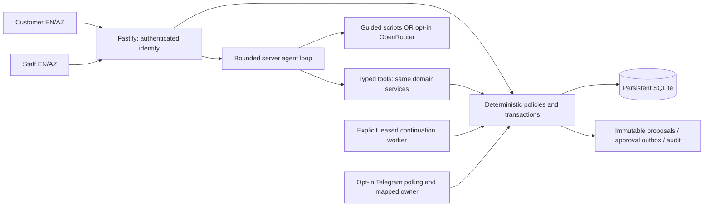

# Architecture and decisions

Status: bilingual storefront/workspace, bounded assistants, durable human approvals,
sandbox purchasing and explicit receipt/inspection/allocation are implemented. The
credential-free visitor launcher serves API/UI together. Live model and Telegram are
separately configured opt-ins; all supplier/payment/delivery events remain synthetic.
See [process states/recovery](processes.md), [setup](setup.md) and [limitations](limitations.md).

## ADR 001: independently deployable clients and server

Choose React with TypeScript and Vite for the bilingual storefront and business
panel. The same typed API supports both experiences and the customer assistant. A
client SPA suits interactive case timelines, persistent language selection and process
inspection. The agreed premium visual direction is implemented in `src/web`; customer
and staff routes share translation/control code. Vite proxies API requests locally.
The server still validates every identity, argument and state-changing action.

Choose Fastify 5, TypeScript 5 and strict Zod 4 contracts for the server. The initial
API runs without credentials. All model tools invoke the same domain services as
manual operations; agents do not execute SQL or provide their own authority.

Repository: `src/web` UI, `src/server` HTTP/config/static visitor entry, `src/domain`
policies, `src/db` storage/fixtures, `src/shared` contracts, `src/agent` orchestration,
`src/worker` continuation, `src/telegram` polling, `src/model` adapters/budget,
`src/evaluation` measurement, `migrations` immutable SQL, `scripts` explicit commands,
`test` isolated checks and `docs` public portfolio material.

The model chooses tools and drafts grounded explanations. Services enforce identities,
accepted specifications, exact AZN integers, quote validity, budgets, consent and human
approval. Tool effects/audit/checkpoints are atomic; no model-generated role or purchase
claim grants authority. Approval authorizes a proposal, not inspected stock or delivery.

## ADR 002: SQLite and checked SQL migrations

Use SQLite through Node 22's built-in `node:sqlite` behind `Store`. This avoids native
dependency compilation on Windows and provides transactional, persistent state without
a separate database server. Pin the supported Node major to 22. The Node 22 SQLite API
is experimental; the adapter limits the surface that may need replacing. Tests and CI
exercise the pinned major. No promise of compatibility with Node 23–26 is made.

Enable foreign keys, WAL and a bounded busy timeout. `BEGIN IMMEDIATE` wraps every
business mutation and idempotency result. Transactions contain synchronous database work
only: never await a provider or network call while holding the SQLite write lock.
Migration version/checksum records detect modification after application. Add a new SQL
migration rather than changing an applied one. Store quantities and AZN minor units as
integers. Model cost uses integer micro-USD, nullable when unknown.

The runner applies ordered numbered migrations and verifies every applied checksum.
Migration 002 upgrades existing supplier records to version 1 without replacing them,
adds supplier update timestamps and separate quotation-recording metadata, and protects
quotation rows/metadata with SQL update/delete triggers. A revision inserts a new row
under a unique supplier/product/version; existing evidence remains immutable. Legacy
quotation timestamps/reasons stay unknown rather than being invented by the upgrade.
Fresh demo fixtures include their synthetic recording metadata. Version checks, inserts,
audit and idempotency responses commit together under the same immediate transaction.

Deploy a single backend instance with persistent disk and backup/restore before public
live hosting. SQLite is a single-writer choice; synchronous queries block the Node event
loop. It is appropriate for this bounded portfolio application, not a demonstrated
high-volume multi-instance architecture. A future Postgres adapter and leased queue can
replace storage if scaling requires it. Do not place this database on ephemeral storage
or a shared network filesystem.

## ADR 003: durable processes, jobs and Telegram

Persist process checkpoints and a job outbox in the same transaction as the business
event. Explicit workers atomically lease ready jobs, increment attempts, set an expiry,
and recover expired leases after restart. Unique dedupe keys prevent duplicate jobs;
idempotent business effects handle the crash between effect commit and job completion.
Use bounded attempts/backoff and terminal escalation, not infinite retries. The continuation executor runs only through an explicit worker command.

Process states: ready, running, waiting_approval, waiting_supply, completed, escalated,
failed. Checkpoints contain the step, case ID and accepted consent/proposal references.
Use versioned compare-and-set updates to reject stale workers. Waiting processes hold no
in-memory timer as their only source of truth. Poll persisted deadlines and ready jobs;
check expiry again at the action boundary. Business dates never depend on session time.

Telegram local development uses opt-in long polling, persisted update IDs and offset,
without an inbound tunnel. Future hosted operation would need an HTTPS webhook validated using
Telegram's webhook secret header, plus explicit Telegram user/chat-to-account mapping.
Callbacks reference an opaque request ID, not a role or amount supplied by Telegram text.
Bot onboarding, mapped private callbacks and leased send/receive adapters are implemented.
See [Telegram approvals](telegram-approvals.md) for uncertain-send recovery and the
persisted continuation; hosted webhooks remain unimplemented.

Proposals are immutable after submission. Expiry is min(quote expiry, submission+24h).
First valid authorized decision wins. In one transaction record the decision, reserve
budget and enqueue continuation; repeats return the prior decision. On execution,
revalidate consent, requirements, quote version/expiry and budget. Material changes
invalidate/release the approval and require a new proposal. One proposal maps to at most
one PO. PO creation converts the budget allocation to commitment without adding stock.
Explicit receipt inspections add sellable stock and allocate to still-valid customer demand.

## ADR 004: authority, idempotency and audit

Demo authentication uses scrypt password hashes and opaque random bearer sessions.
Only SHA-256 session-token hashes are stored; expiry uses the real wall clock even when
business fixtures use a frozen clock. Log out removes the token. Login is bounded per
IP for local development. The UI retains bearer sessions in sessionStorage, not query strings or durable localStorage. Public hosting needs HTTPS, public-demo isolation/reset rules,
deployment rate limits and a reviewed authentication strategy. Current host is loopback
only; shared known fixture passwords are not production credentials.

Each route obtains roles and identity from the session record. Customer operations use
that account's records. Purchasers can read orders linked to procurement cases; operators
and owners can perform their explicitly allowed business actions. Missing and concealed
orders share `ORDER_NOT_FOUND`. Strict contracts reject unknown role/customer fields.

Mutation keys are scoped by authenticated account and operation. Store a fingerprint
of the normalized request and exact response in the same transaction as all effects.
Same key/same arguments returns the recorded result; changed arguments conflict. A new
key still cannot consume the same offer or refund twice. Retried responses are historical
operation outcomes: query the order again to retrieve its current status.

Audit events contain actor, action, entity, correlation, validated business data and UTC
time, never credentials. Order-linked events share the order ID as correlation; future
model/tool events reference the process/case. HTTP errors carry an independent server
request ID. Persist audit inside the transaction, so rollback removes both event and
effect. Ordinary application code never updates audit entries; the demo reset rebuilds
the named database including its synthetic history.

## ADR 005: model boundaries and tool contracts

The customer assistant searches products, clarifies requirements, prepares summaries,
retrieves own orders and invokes confirmed customer actions. The procurement assistant
reads linked demand, evaluates quote results and drafts explanations/proposal revisions.
Neither assistant approves a supplier purchase, changes a budget or invents stock.

`src/shared/contracts.ts` defines strict tool inputs, JSON schemas and role metadata.
`src/agent/tools.ts` implements typed dispatch with authenticated session resolution,
assistant allowlists, role checks, customer-only authority and trusted procurement-case
scope. Roles/expiry are rechecked on each call. `src/shared/tool-call.ts` supplies the
same normalized function envelope used by the model adapter. Strict JSON arguments
cannot supply an actor, role or authorization claim. Supplier/customer text is data.

Model-requested confirmation/cancellation/returns yield confirmation_required without
executing a mutation, even if confirmed=true is supplied. The trusted customer UI
obtains affirmative consent and invokes the ordinary authenticated business route,
which revalidates rules. No dispatcher method accepts a model-created consent grant.
See [tool dispatch](tools.md) and [agent loop](agent-loop.md). The internal loop refreshes
authentication before/after inference, serializes exact tool observations and stops for
confirmation. It returns separate invocation-local model/tool records and validates
explicit completion/clarification/escalation against strict terminal JSON and local
evidence references. Escalation destinations come from trusted assistant scope and
are linked to persisted customer support/procurement handoffs by the connected assistant.
Completion closes the assistant turn, not a business process. Authenticated conversation
endpoints and durable execution/resume are implemented.

Deterministic code computes available stock, sale totals, quote MOQ/excess/all-in price,
deadline feasibility, reservation expiry, return eligibility and role/budget thresholds.
The model may choose the next permitted tool and explain recorded alternatives. It may
not replace these calculations with prose. An incomplete/foreign-currency quote remains
ineligible. Missing feasible supply returns clarification/escalation rather than a guess.

## ADR 006: locales and reproducible sandbox

Accounts store `en`/`az` preferences; public catalog accepts an explicit locale defaulting
to English. Product descriptions are bilingual. The UI uses typed English/Azerbaijani
entries checked for missing translations and fixture specification coverage.
Persisted notifications store message keys/parameters and recipient locale.
Assistant/Telegram prose follows the recipient locale. API errors use stable English
codes translated by the bilingual UI.
Language is not part of the consent fingerprint; switching it does not alter an offer.
Store UTC timestamps, format in Asia/Baku, and use the Mon–Fri Baku demo calendar.

Seed six fictional products, five role accounts, three supplier quotes, one delivered
order and one accepted 20-switch shortage order. Fixture business time is frozen at
2026-10-12 08:00 UTC. It is displayed by `/health`, not represented as real current time.
Change `DEMO_CLOCK` to advance business scenarios, restart, then call expiry as operator.
Do not change the fixture date without recalculating stored supplier dates. Reset restores
the same deterministic records/IDs. An interrupted seed is detected and requires reset.

Only the project-relative `runtime/relayops-demo.sqlite` path is accepted by CLI/startup.
Reset requires that connection's `relayops-demo` metadata marker and explicit `--demo-only`.
It rebuilds application tables, never recursively deletes project files. Do not run reset
against an active server. Test-only stores are isolated in memory or temporary directories.

## Publishing and a separate visitor demo

GitHub Pages serves static HTML/CSS/JavaScript. The future frontend may use Pages with a
separately hosted API, explicit API origin/CORS policy and HTTPS authentication review.
SQLite, agent credentials, workers and Telegram handlers stay on that backend.

Elmar selected the full backend product first. If later requested, build a separate
public repository containing a self-contained JavaScript demo for easy presentation and
visitor access. That demo must clearly label simulated approvals/model/supplier actions;
it does not replace or expose the live product's database or keys. No extra repository,
static mock frontend or deployment has been created during this stage.

## Primary technical references

- [Node 22 SQLite API](https://nodejs.org/docs/latest-v22.x/api/sqlite.html)
- [SQLite transactions](https://www.sqlite.org/lang_transaction.html)
- [Fastify supported versions](https://fastify.dev/docs/latest/Reference/LTS/)
- [Zod JSON Schema](https://zod.dev/json-schema)
- [React client application setup](https://react.dev/learn/build-a-react-app-from-scratch)
- [Vite guide](https://vite.dev/guide/)
- [Telegram callbacks](https://core.telegram.org/bots/api#callbackquery)
- [GitHub Pages scope](https://docs.github.com/en/pages/getting-started-with-github-pages/what-is-github-pages)

These sources explain component capabilities. RelayOps's business choices, limitations
and tests are this project's own design and evidence.

## Operations read boundary

Operations builds explicit scoped read contracts for case details, integrated activity,
proposal/decision history, goods handling and run usage. It follows foreign-key business
relationships and exposes selected fields, not whole private payloads. Purchasers read
procurement records; operators read goods handling without financial decisions; owners
retain the full summary scope. Reads do not advance process checkpoints or execute the
prepared approval/PO/receipt schema. No new migration is needed for these views.

The main named demo remains unchanged by populated-view verification. Isolated test
fixtures populate the schema to verify rendering/visibility. Approval, continuation and
receipt services are verified separately; populated views alone do not prove execution.

## OpenRouter adapter boundary

`src/model/openrouter.ts` implements bounded text/function-call Chat Completions with
native server-side fetch. Model/provider IDs come from validated environment settings.
Each call verifies unauthenticated endpoint metadata before reserving money and sending
the key to the fixed HTTPS completion origin. Redirects are refused. Input, output,
response body and time are bounded; unsupported tool names/response shapes are rejected.
The adapter returns model requests; it never executes a business function itself.

`ModelBudget` uses Store's synchronous BEGIN IMMEDIATE transactions in the separate
`runtime/model-budget.sqlite`. All live diagnostic attempts share its original USD 1
ceiling. Reservations cover full advertised context at the highest cache/long-context
input rate, capped output at the highest completion/reasoning rates and a 10% margin.
Unknown outcomes remain held across restart. Known costs settle independently of prose
validity. An observed billing overrun stops subsequent calls. The business-demo reset
never touches this ledger. Its schema is independent of immutable business migrations.

This is application accounting for this project, not an OpenRouter account/key limit.
It assumes provider catalogue prices and token caps are honored; unrelated key use is
outside its accounting. Live agent entry points always use this adapter/ledger,
persist all execution outcomes and supply trusted actor context to a validated dispatcher.
No public completion endpoint or website conversation exists yet. The explicit local
diagnostic stores actual usage and a synthetic tool result in existing run/usage tables.

## Durable agent turns

Migration 003 adds account/agent/case-scoped conversations and leased execution state.
Conversations starts a bounded turn, resumes an interrupted local checkpoint or returns a
cached terminal outcome. Tool effects, existing audit, separate typed evidence and cursor
updates commit together using synchronous nested savepoints. No transaction spans inference.
A provider call interrupted by a crash is never automatically replayed. Known/unknown
usage persists independently of reply validity, with the separate shared spending ledger.
See [agent execution](agent-loop.md) for limits, recovery and human boundaries.

This service is internal; it does not expose an unmetered completion endpoint, start
inference on server startup, create Telegram approvals or execute purchasing jobs.
Explicit mock/live diagnostics use the same authenticated business-tool boundaries.

## Procurement draft orchestration

Phase 11 adds a case-scoped authenticated asynchronous entry point using Conversations,
the same adapter/budget and a distinct explicit ProcurementMock. Accepted consent defines
specifications; effective reservations define remaining demand. Procurement captures
transactionally coherent requirements, latest quotes/capabilities, budget and deterministic
alternatives. A fingerprint plus expected version gates immutable draft preparation.
The server selects/computes all business fields; EN/AZ explanations and a separately
labelled original-language model note are saved in the proposal snapshot.

Migrations 005/006 add durable procurement request bindings and protect all proposal versions,
including drafts. Revision inserts another version and supersedes only an old draft.
Model tools commit proposal/audit/evidence/checkpoint together; committed proposals survive
explanation failure and restart without duplicate effects. Reads compute stale/expired
status without rewriting history. Both assistants share live admission and the original
spending guard. Draft preparation does not itself execute Telegram approval, budget
allocation, PO or receipt; these are separate human/worker services.
See [procurement assistant](procurement-agent.md).

## Receipt and customer fulfillment

`Fulfillment` uses synchronous authenticated business effects for explicit goods receipt,
immutable inspection, sellable movements, linked reservation/allocation and order readiness.
Migration 009 preserves receipt binding, serial identity, terminal inspection and append-only
allocation/supplier-event evidence. In-app notifications commit with their originating effect.
Scoped progress reads expose only customer operational fields. Actual receipt/inspection
timestamps support delivery calculations; material date/consent changes require review.

Supplier delay/cancellation records mock evidence, preserves received obligations and releases
only acknowledged cancelled costs. Explicit deterministic replan binds a fresh draft to the
reopened case and current remaining demand/budget; no old approval transfers. Outstanding PO
quantities/pending inspection block competing purchase obligations. The explicit business worker
still only continues approval/rejection: API/bot startup does not fabricate receipt, inspection,
dispatch, delivery or paid inference. See [goods handling](goods-fulfillment.md).
