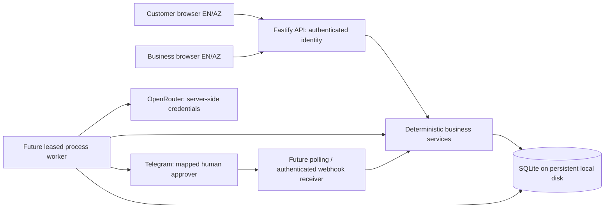

# Architecture and decisions

Status: backend foundation and bilingual storefront/operations UI implemented.
OpenRouter, Telegram, durable job execution and purchasing/receipt orchestration are
future implementation stages. Their records exist, but no live integration runs yet.

## ADR 001: independently deployable clients and server

Choose React with TypeScript and Vite for the bilingual storefront and business
panel. The same typed API supports both experiences and the customer assistant. A
client SPA suits interactive case timelines, persistent language selection and process
inspection. The agreed premium visual direction is implemented in `src/web`; customer
and staff routes share translation/control code. Vite proxies API requests locally.
The server still validates every identity, argument and state-changing action.

Choose Fastify 5, TypeScript 5 and strict Zod 4 contracts for the server. The initial
API runs without credentials. All model tools will invoke the same domain services as
manual operations; agents do not execute SQL or provide their own authority.

The diagram includes future components, not proof of implemented integrations.
Repository layout: `src/web` contains the UI, `src/server` handles HTTP/config,
`src/domain` for policies, `src/db` for storage/fixtures, `src/shared` for contracts,
`src/worker` for future workers, `migrations` for SQL, `scripts` for maintenance,
`test` for isolated verification and `docs` for public product documentation.

## ADR 002: SQLite and checked SQL migrations

Use SQLite through Node 22's built-in `node:sqlite` behind `Store`. This avoids native
dependency compilation on Windows and provides transactional, persistent state without
a separate database server. Pin the supported Node major to 22. The Node 22 SQLite API
is experimental; the adapter limits the surface that may need replacing. Tests and CI
exercise the pinned major. No promise of compatibility with Node 23–26 is made.

Enable foreign keys, WAL and a bounded busy timeout. `BEGIN IMMEDIATE` wraps every
business mutation and idempotency result. Transactions contain synchronous database work
only: never await a provider or network call while holding the SQLite write lock.
Migration version/checksum records detect modification after application. Add a new SQL
migration rather than changing an applied one. Store quantities and AZN minor units as
integers. Model cost uses integer micro-USD, nullable when unknown.

Deploy a single backend instance with persistent disk and backup/restore before public
live hosting. SQLite is a single-writer choice; synchronous queries block the Node event
loop. It is appropriate for this bounded portfolio application, not a demonstrated
high-volume multi-instance architecture. A future Postgres adapter and leased queue can
replace storage if scaling requires it. Do not place this database on ephemeral storage
or a shared network filesystem.

## ADR 003: durable processes, jobs and Telegram

Persist process checkpoints and a job outbox in the same transaction as the business
event. Future workers atomically lease ready jobs, increment attempts, set an expiry,
and recover expired leases after restart. Unique dedupe keys prevent duplicate jobs;
idempotent business effects handle the crash between effect commit and job completion.
Use bounded attempts/backoff and terminal escalation, not infinite retries. The worker
executor is deliberately scheduled with agent/approval integration, not this foundation.

Process states: ready, running, waiting_approval, waiting_supply, completed, escalated,
failed. Checkpoints contain the step, case ID and accepted consent/proposal references.
Use versioned compare-and-set updates to reject stale workers. Waiting processes hold no
in-memory timer as their only source of truth. Poll persisted deadlines and ready jobs;
check expiry again at the action boundary. Business dates never depend on session time.

Telegram local development will use long polling, persisted update IDs and offset,
without an inbound tunnel. Hosted operation will use an HTTPS webhook validated using
Telegram's webhook secret header, plus explicit Telegram user/chat-to-account mapping.
Callbacks reference an opaque request ID, not a role or amount supplied by Telegram text.
Send/receive adapters, bot setup, mappings and actual callbacks remain future work.

Proposals are immutable after submission. Expiry is min(quote expiry, submission+24h).
First valid authorized decision wins. In one transaction record the decision, reserve
budget and enqueue continuation; repeats return the prior decision. On execution,
revalidate consent, requirements, quote version/expiry and budget. Material changes
invalidate/release the approval and require a new proposal. One proposal maps to at most
one PO. PO creation converts the budget allocation to commitment without adding stock.
Receipts later add inspected stock and allocate to still-valid customer demand.

## ADR 004: authority, idempotency and audit

Demo authentication uses scrypt password hashes and opaque random bearer sessions.
Only SHA-256 session-token hashes are stored; expiry uses the real wall clock even when
business fixtures use a frozen clock. Log out removes the token. Login is bounded per
IP for local development. Tokens must later be held in browser memory, not query strings
or durable localStorage. Public hosting needs HTTPS, public-demo isolation/reset rules,
deployment rate limits and a reviewed authentication strategy. Current host is loopback
only; shared known fixture passwords are not production credentials.

Each route obtains roles and identity from the session record. Customer operations use
that account's records. Purchasers can read orders linked to procurement cases; operators
and owners can perform their explicitly allowed business actions. Missing and concealed
orders share `ORDER_NOT_FOUND`. Strict contracts reject unknown role/customer fields.

Mutation keys are scoped by authenticated account and operation. Store a fingerprint
of the normalized request and exact response in the same transaction as all effects.
Same key/same arguments returns the recorded result; changed arguments conflict. A new
key still cannot consume the same offer or refund twice. Retried responses are historical
operation outcomes: query the order again to retrieve its current status.

Audit events contain actor, action, entity, correlation, validated business data and UTC
time, never credentials. Order-linked events share the order ID as correlation; future
model/tool events reference the process/case. HTTP errors carry an independent server
request ID. Persist audit inside the transaction, so rollback removes both event and
effect. Ordinary application code never updates audit entries; the demo reset rebuilds
the named database including its synthetic history.

## ADR 005: model boundaries and tool contracts

The customer assistant searches products, clarifies requirements, prepares summaries,
retrieves own orders and invokes confirmed customer actions. The procurement assistant
reads linked demand, evaluates quote results and drafts explanations/proposal revisions.
Neither assistant approves a supplier purchase, changes a budget or invents stock.

`src/shared/contracts.ts` defines strict tool inputs, JSON schemas and role metadata.
The future dispatcher must check the authenticated actor, the tool allowlist for the
selected assistant and the service policy. Do not expose confirmation tools as unilateral
model consent: dispatch them only with a trusted customer-confirmation event from the UI.
Supplier/customer text is untrusted evidence. There is no tool dispatcher/model loop yet.

Deterministic code computes available stock, sale totals, quote MOQ/excess/all-in price,
deadline feasibility, reservation expiry, return eligibility and role/budget thresholds.
The model may choose the next permitted tool and explain recorded alternatives. It may
not replace these calculations with prose. An incomplete/foreign-currency quote remains
ineligible. Missing feasible supply returns clarification/escalation rather than a guess.

## ADR 006: locales and reproducible sandbox

Accounts store `en`/`az` preferences; public catalog accepts an explicit locale defaulting
to English. Product descriptions are bilingual. The UI uses typed English/Azerbaijani
entries checked for missing translations and fixture specification coverage. Future
persisted notifications store message keys/parameters and recipient locale.
Assistant/Telegram prose follows the recipient locale. API errors use stable English
codes translated by the bilingual UI.
Language is not part of the consent fingerprint; switching it does not alter an offer.
Store UTC timestamps, format in Asia/Baku, and use the Mon–Fri Baku demo calendar.

Seed six fictional products, five role accounts, three supplier quotes, one delivered
order and one accepted 20-switch shortage order. Fixture business time is frozen at
2026-10-12 08:00 UTC. It is displayed by `/health`, not represented as real current time.
Change `DEMO_CLOCK` to advance business scenarios, restart, then call expiry as operator.
Do not change the fixture date without recalculating stored supplier dates. Reset restores
the same deterministic records/IDs. An interrupted seed is detected and requires reset.

Only the project-relative `runtime/relayops-demo.sqlite` path is accepted by CLI/startup.
Reset requires that connection's `relayops-demo` metadata marker and explicit `--demo-only`.
It rebuilds application tables, never recursively deletes project files. Do not run reset
against an active server. Test-only stores are isolated in memory or temporary directories.

## Publishing and a separate visitor demo

GitHub Pages serves static HTML/CSS/JavaScript. The future frontend may use Pages with a
separately hosted API, explicit API origin/CORS policy and HTTPS authentication review.
SQLite, agent credentials, workers and Telegram handlers stay on that backend.

Elmar selected the full backend product first. If later requested, build a separate
public repository containing a self-contained JavaScript demo for easy presentation and
visitor access. That demo must clearly label simulated approvals/model/supplier actions;
it does not replace or expose the live product's database or keys. No extra repository,
static mock frontend or deployment has been created during this stage.

## Primary technical references

- [Node 22 SQLite API](https://nodejs.org/docs/latest-v22.x/api/sqlite.html)
- [SQLite transactions](https://www.sqlite.org/lang_transaction.html)
- [Fastify supported versions](https://fastify.dev/docs/latest/Reference/LTS/)
- [Zod JSON Schema](https://zod.dev/json-schema)
- [React client application setup](https://react.dev/learn/build-a-react-app-from-scratch)
- [Vite guide](https://vite.dev/guide/)
- [Telegram callbacks](https://core.telegram.org/bots/api#callbackquery)
- [GitHub Pages scope](https://docs.github.com/en/pages/getting-started-with-github-pages/what-is-github-pages)

These sources explain component capabilities. RelayOps's business choices, limitations
and tests are this project's own design and evidence.
