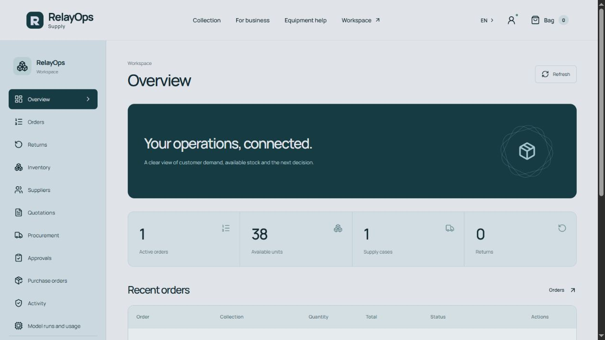
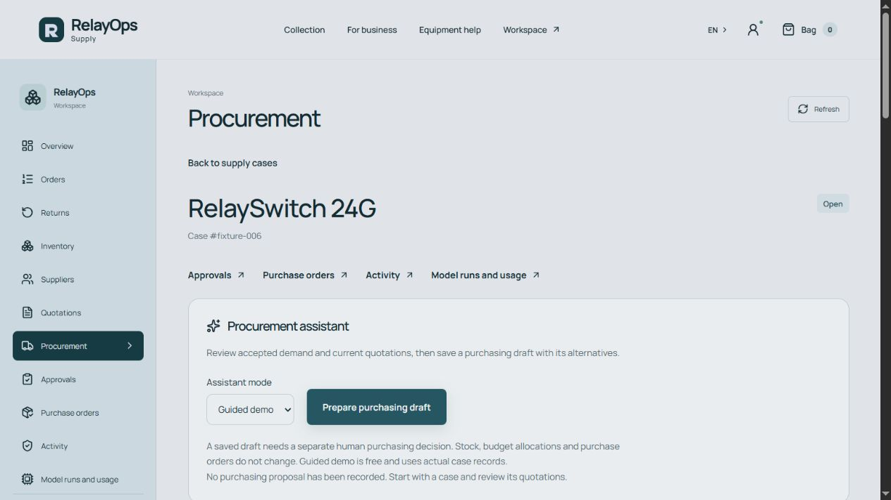
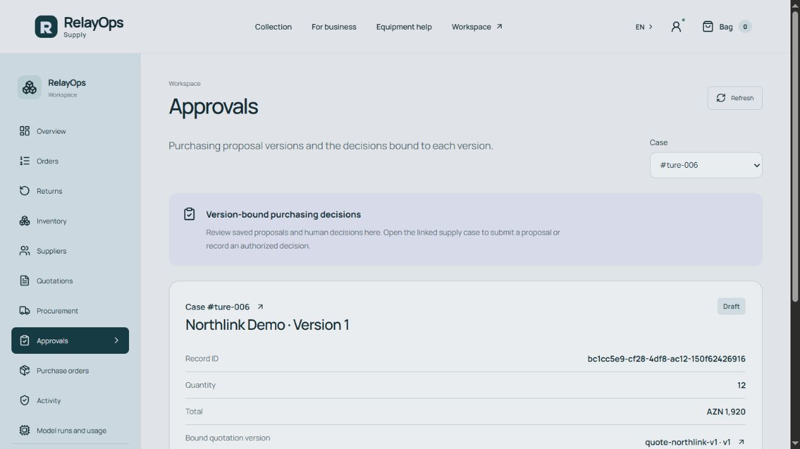
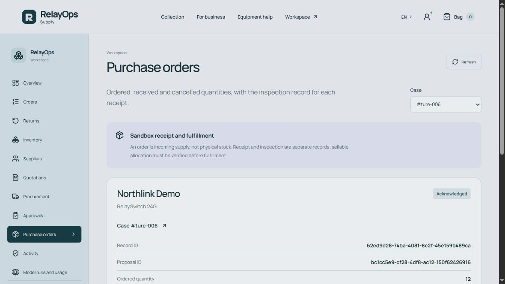
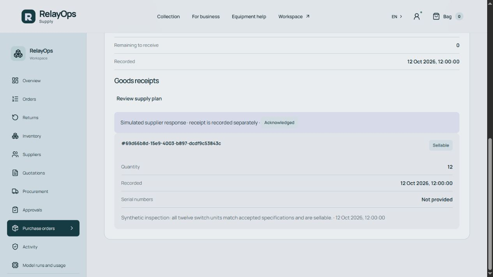
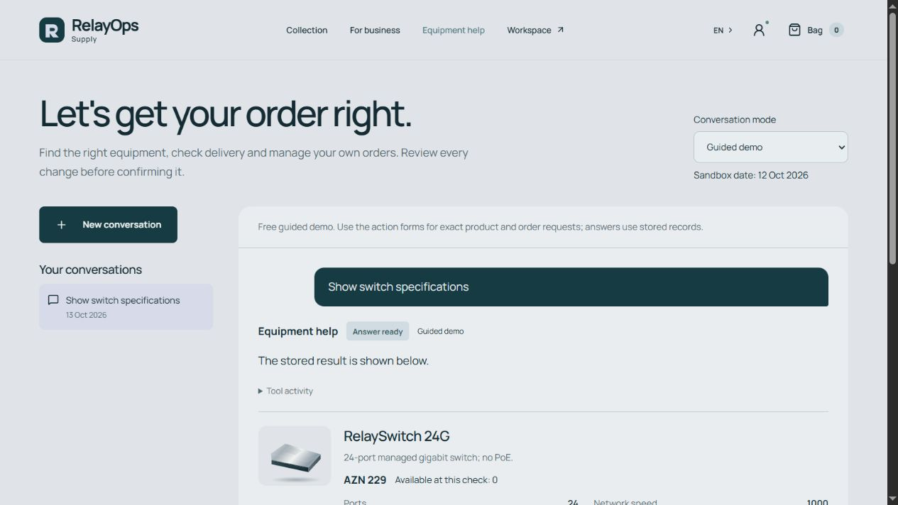
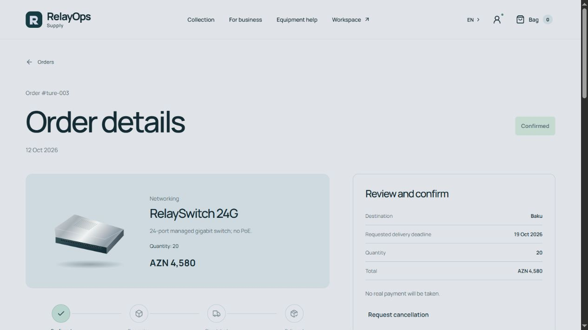

# Portfolio evidence and reproducible launch

The source, English documentation and credential-free visitor mode are ready for local
portfolio review. Hosted deployment is not part of this delivery.

## Short integrated recording

[Watch the 33-second English sandbox walkthrough](media/demo-en.mp4)
([caption transcript](media/demo-en.srt)). H.264, 1266×712, no audio.

This is an **edited UI recording**, assembled from actual browser captures sampled at
two frames per second and encoded at 24 fps. Sign-in, idle pauses, terminal invocation
and the intervening interactions are removed; the observed states are retained in order.
It is not a real-time screen recording, timing benchmark or live model evaluation.

It shows storefront → workspace → accepted procurement case → guided 12-unit / 1,920-AZN
draft → versioned proposal → explicit simulated approval → one acknowledged PO → receipt
pending inspection → sellable inspection → customer assistant → customer B's confirmed
20-unit order. All twenty units are reserved; final customer delivery has **not** occurred.
The explicit credential-free worker runs between approval and PO capture. No real Telegram,
supplier/payment service or paid inference is used.

## English captures

Additional captures: [saved draft](media/draft-en.jpg), [simulated approval](media/approval-en.jpg),
[receipt before inspection](media/receipt-en.jpg), [390px storefront](media/storefront-mobile-en.jpg).

All captures use a separate synthetic checkout with public fixture accounts. No operator
configuration, private Telegram identifiers, personal data or raw trial payloads is included.
The screenshot file extensions reflect the browser's JPEG output. Media hashes/provenance
are in [the manifest](media/manifest.json). The original named demo was not changed.

## Verification on 2026-10-13

Environment: Windows PowerShell, Node **22.23.2**, npm **10.9.8**, in-app Chromium.
The source revision identifies this portfolio implementation in repository history;
the evaluation's original execution snapshot is a separate earlier revision.

| Check                       | Observed scope                                                                                                                                                   |
| --------------------------- | ---------------------------------------------------------------------------------------------------------------------------------------------------------------- |
| Full application suite      | 260/261 tests plus types, lint, formatting, API/UI build and public-content scan passed.                                                                         |
| Compiled API smoke          | Real health and Azerbaijani catalog HTTP checks passed; owned child exited.                                                                                      |
| Credential-free launch      | A separate clean Git clone with no dependencies/runtime started with the documented install/build/serve command.                                                 |
| Live isolation              | Visitor entry ignored live shell flags and a synthetic `.env` enabling live integrations; assistants/Telegram remained unavailable for live execution.           |
| Same-origin UI              | Storefront/deep case links worked; missing assets and unknown API paths returned 404.                                                                            |
| Integrated scenario         | Real domain services saved 12-unit/192000-minor-unit proposal, simulated owner decision, one PO, receipt and twelve-unit linked allocation.                      |
| Duplicate worker            | Second explicit visitor worker execution created no second PO or physical stock.                                                                                 |
| Restart / shutdown          | Graceful owned-launcher shutdown/restart retained PO/allocation; no unintended listener remained.                                                                |
| Port contention             | Competing startup failed; the original isolated listener remained healthy.                                                                                       |
| Reset                       | After stopping isolated processes, documented reset returned the fresh scenario and preserved a separately created synthetic SQLite ledger marker byte-for-byte. |
| UI capture                  | English desktop workflow had no observed console errors; 390px storefront scroll/client widths both 375px, with viewport override reset.                         |
| Original-state preservation | Exact original `.env`, both logical SQLite database dumps and all 120 pre-existing main evaluation files unchanged.                                              |

Verification used no live network integrations other than installing packages from npm.
The existing Vite >500 kB JavaScript advisory and experimental Node SQLite warning remain;
they do not fail the recorded checks. No physical-device or public-deployment claim is made.

## Repeat the local review

Follow [setup](setup.md) in a separate checkout and [demo walkthrough](demo.md). Use
`npm run demo:worker` only when the synthetic owner has approved the visitor proposal.
Stop that checkout before reset. Default launch retains previous business data; it does
not silently restore the initial screenshots.

For translated maintenance see [localization](localization.md). For actual repeated live
outcomes see [evaluation results](evaluation-results.md), with assisted-human limitations.
Recorded media is a synthetic guided demonstration, not a replacement experiment.
