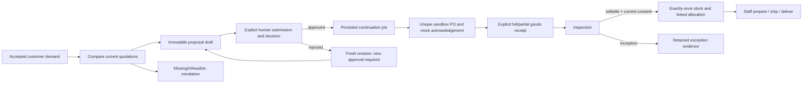

# Process states, human decisions and recovery

Read labels as separate layers: a saved draft, human approval, supplier acknowledgement,
receipt, sellable allocation and customer delivery each require their own evidence.

## State ownership

| Record                | Stored states / meaning                                                                                                                                             |
| --------------------- | ------------------------------------------------------------------------------------------------------------------------------------------------------------------- |
| Customer order        | `draft`, `awaiting_supply`, `confirmed`, `processing`, `cancellation_requested`, `shipped`, `delivered`, `cancelled`; staff/customer policies restrict transitions. |
| Procurement case      | `open`, `waiting`, `committed`, `closed`, `escalated`; closure is distinct from assistant-turn completion.                                                          |
| Proposal              | `draft`, `pending_approval`, `approved`, `rejected`, `expired`, `superseded`, `invalidated`, `executed`; immutable evidence/version survives later decisions.       |
| Approval request      | `pending`, `approved`, `rejected`, `expired`, `invalidated`; first valid authorized decision wins across website/Telegram.                                          |
| Budget allocation     | `reserved`, `committed`, `released`; approval reserves, PO creation commits, applicable cancellation releases.                                                      |
| PO                    | `created`, `acknowledged`, `partially_received`, `received`, `cancelled`, `failed`; acknowledgement adds no physical stock.                                         |
| Job                   | `ready`, `leased`, `done`, `failed`; the explicit worker claims and executes bounded continuation jobs.                                                             |
| Assistant request/run | Durable queued/executing/checkpoint/terminal outcomes; tool effects and next checkpoint commit together; completion closes a turn, not an order.                    |

Process checkpoints identify the accepted consent, case, proposal and current step.
Approved decisions queue `purchase.after_approval`; rejection queues
`procurement.after_rejection`. The worker revalidates evidence before effects.
Read each layer's latest record rather than treating one status as the whole process.

## Approval semantics

Approval binds one proposal/version, exact all-in amount, latest quotation, accepted
specifications and deadline to the authorized owner. Expiry is bounded by quotation
validity and submission plus 24 hours, with real-wall and frozen-business bounds.
Changed quote/capability/stock/consent/budget, expiry or revoked authority blocks the
action and requires a fresh proposal/decision. The request's own budget reservation
is excluded from comparison; other commitments still count. A model cannot supply
owner identity, approve itself or turn `confirmed=true` into customer consent.

## Recovery and duplicate behavior

- Transactions commit effect, audit, idempotency response and durable checkpoint
  together. Same account/operation/key and identical input return the recorded result;
  changed input conflicts. Unique bindings prevent duplicate PO/receipt effects.
- After restart, load the same business database and model ledger. Cached polling and
  resume do not start new inference; a committed tool checkpoint is not executed again.
  An ambiguous in-flight paid model request is not blindly replayed.
- Leased jobs recover after their persisted lease expires. No transaction stays open
  across a network call. Explicit worker commands control continuation; API startup
  does not purchase, receive or send approval messages.
- Telegram decision and update offset commit together. Ambiguous `sendMessage` becomes
  **delivery unknown**, without automatic resend. An authenticated mapped callback may
  recover the message binding; otherwise the website/database decision is authoritative.
  Terminal edit retries are bounded. Restart a failed receiver after inspecting its
  fixed error and allowing the old lease to expire.
- Received units pending inspection do not become sellable stock. Inspection records
  actual inventory once; changed/expired customer consent can still block allocation.
  Cancelled demand does not erase supplier obligations. Delay/cancellation/replan retains
  evidence and requests new approval for a replacement purchase.

Focused details: [agent checkpoints](agent-loop.md), [approval recovery](telegram-approvals.md),
[purchasing continuation](purchase-continuation.md), [goods fulfillment](goods-fulfillment.md)
and [verified difficult cases](difficult-cases.md). These are bounded sandbox guarantees,
not general production durability or security claims.
